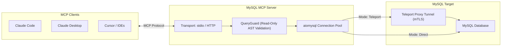

<div align="center">

# 🐬 MySQL Model Context Protocol (MCP) Server

[](https://www.python.org/)
[](https://github.com/jlowin/fastmcp)
[](https://opensource.org/licenses/MIT)
[](https://github.com/david-evaristo/mysql-mcp-server/releases)
[](https://github.com/astral-sh/ruff)

**A secure, production-grade, read-only MCP server to query MySQL databases via Direct Connection or Teleport Access.**

[Features](#-key-features) • [Architecture](#-architecture) • [Quickstart](#-quickstart) • [Tools & Resources](#-tools--resources) • [Security](#-security-architecture) • [Configuration](#-configuration) • [Development](#-development--contributing)

</div>

---

## ⚡ Overview

The **MySQL MCP Server** connects AI coding assistants and LLMs (such as **Claude Code**, **Claude Desktop**, and **Cursor**) directly to your MySQL clusters using the [Model Context Protocol (MCP)](https://modelcontextprotocol.io/).

Designed with a **defense-in-depth read-only security model**, it allows models to inspect database schemas, search tables, sample data, and safely execute analytic `SELECT` queries without risking data modification.

---

## ✨ Key Features

- 🛡️ **Guaranteed Read-Only**: Enforces read-only sessions via MySQL protocol (`SET SESSION TRANSACTION READ ONLY`) and blocks 27+ write/DDL keywords (including within comments and subqueries).
- 🔐 **Dual Connection Modes**:
  - **Teleport Access (Default)**: Connects via local Teleport mTLS tunnel with zero long-lived database credentials stored in client config.
  - **Direct MySQL**: Connects directly to any MySQL 5.7+ / 8.0+ instance with username/password and optional SSL/TLS CA verification.
- ⚡ **High Performance & Async**: Built on `aiomysql` with intelligent connection pooling and TTL-based schema caching.
- 🚦 **Safety Rails**: Automatic `LIMIT` injection/capping, per-query execution timeouts, and configurable request rate limiting.
- 🌐 **Flexible Transports**: Native `stdio` transport for desktop IDEs, plus an independent `HTTP/SSE` mode for remote services and containers.

---

## 🏗 Architecture



---

## 🚀 Quickstart

### Prerequisites

- [uv / uvx](https://docs.astral.sh/uv/) installed on your machine (`curl -LsSf https://astral.sh/uv/install.sh | sh`)
- **Teleport mode**: Authenticated `tsh` session (`tsh db login <db-name>` and `tsh proxy db <db-name> --tunnel`)
- **Direct mode**: MySQL user credentials with `SELECT`-only privileges

<details>
<summary><b>📋 MySQL User Setup (DBA Script)</b></summary>

```sql
-- Create read-only user
CREATE USER 'mcp_readonly'@'%' IDENTIFIED BY 'secure_password';

-- Grant SELECT on target databases
GRANT SELECT ON `my_database`.* TO 'mcp_readonly'@'%';

-- Allow reading information_schema (required for list_tables / describe_table)
GRANT SELECT ON information_schema.* TO 'mcp_readonly'@'%';

FLUSH PRIVILEGES;
```
</details>

---

### Configuration by Client

<details open>
<summary><b>Claude Desktop</b></summary>

Edit your `claude_desktop_config.json`:
- **macOS**: `~/Library/Application Support/Claude/claude_desktop_config.json`
- **Windows**: `%APPDATA%\Claude\claude_desktop_config.json`
- **Linux**: `~/.config/Claude/claude_desktop_config.json`

```json
{
  "mcpServers": {
    "mysql": {
      "command": "uvx",
      "args": [
        "--from", "git+https://github.com/david-evaristo/mysql-mcp-server.git@v1.1.0",
        "mysql-mcp-server"
      ],
      "env": {
        "MYSQL_CONNECTION_MODE": "direct",
        "MYSQL_HOST": "mysql.example.com",
        "MYSQL_PORT": "3306",
        "MYSQL_USER": "mcp_readonly",
        "MYSQL_PASSWORD": "secure_password"
      }
    }
  }
}
```

> [!TIP]
> For **Teleport mode**, set `"MYSQL_CONNECTION_MODE": "teleport"`, `"MYSQL_HOST": "127.0.0.1"`, and `"MYSQL_PORT"` to your local tunnel port. No password is required.

</details>

<details>
<summary><b>Claude Code (CLI)</b></summary>

Register the server using the `claude mcp add` command:

**Option 1 — Direct Connection:**
```bash
claude mcp add mysql -s user \
  --env MYSQL_CONNECTION_MODE=direct \
  --env MYSQL_HOST=mysql.example.com \
  --env MYSQL_PORT=3306 \
  --env MYSQL_USER=mcp_readonly \
  --env MYSQL_PASSWORD=secure_password \
  -- uvx --from git+https://github.com/david-evaristo/mysql-mcp-server.git@v1.1.0 mysql-mcp-server
```

**Option 2 — Teleport Mode:**
```bash
claude mcp add mysql -s user \
  --env MYSQL_CONNECTION_MODE=teleport \
  --env MYSQL_HOST=127.0.0.1 \
  --env MYSQL_PORT=54855 \
  --env MYSQL_USER=db-readonly \
  -- uvx --from git+https://github.com/david-evaristo/mysql-mcp-server.git@v1.1.0 mysql-mcp-server
```

Or add to `~/.claude.json` under `mcpServers`.

</details>

<details>
<summary><b>Cursor & Other MCP Clients</b></summary>

In Cursor Settings > Features > MCP Servers:
- **Name**: `mysql`
- **Type**: `command`
- **Command**: `uvx --from git+https://github.com/david-evaristo/mysql-mcp-server.git@v1.1.0 mysql-mcp-server`
- Configure environment variables via your `.env` or the client settings interface.

</details>

<details>
<summary><b>Running via HTTP / Microservice Mode</b></summary>

Start the server independently over HTTP:

```bash
MCP_TRANSPORT=http PORT=8000 python -m src.server
```

Then attach to it from your MCP client:
```bash
claude mcp add mysql --transport http http://127.0.0.1:8000
```

</details>

---

## 🛠️ Tools & Resources

### MCP Tools

| Tool | Parameters | Description |
|---|---|---|
| `list_databases` | — | Lists all user databases in the cluster (excludes system DBs). |
| `list_tables` | `database: str` | Lists tables with size (MB) and estimated row counts. |
| `describe_table` | `database: str, table: str` | Returns columns, data types, indexes, and constraints. |
| `execute_query` | `query: str, database?: str` | Safely executes a read-only `SELECT` query with automatic `LIMIT`. |
| `search_tables` | `pattern: str` | Searches for tables matching a `LIKE` pattern across the entire cluster. |
| `get_table_sample` | `database: str, table: str, limit?: int` | Returns a sample of rows to inspect data shape without manual SQL. |

### MCP Resources

Exposes database metadata as navigable MCP resources:
- `schema://databases` — Lists all accessible database names.
- `schema://{database}/tables` — Lists all table definitions in the specified database.

---

## 🔒 Security Architecture

> [!IMPORTANT]
> This server is strictly designed for **read-only analytics**. Any modification or administrative operation is rejected by design.

1. **Protocol-Level Enforcement**: Automatically executes `SET SESSION TRANSACTION READ ONLY` on each pool connection checkout.
2. **AST & Keyword Validation**: Blocks write statements and 27 dangerous keywords (`DROP`, `ALTER`, `UPDATE`, `DELETE`, `INTO OUTFILE`, `SET`, `FLUSH`, `SHUTDOWN`, etc.) even inside SQL comments or subqueries.
3. **Identifier Sanitization**: All database and table names are validated against `^[A-Za-z0-9_$]+$`.
4. **Automatic Limit Injection**: Enforces a configurable cap (`MCP_MAX_ROWS`, default 500) and injects `LIMIT` clauses into root queries if omitted.
5. **Rate Limiting & Timeouts**: Defends against runaway loops with configurable call rate limits (`MCP_RATE_LIMIT`) and query timeouts (`MCP_QUERY_TIMEOUT`).
6. **No Secret Leaks**: Passwords and connection secrets are loaded strictly from environment variables and stripped from logs, exceptions, and `repr` strings.

---

## ⚙️ Configuration

| Category | Variable | Default | Mode | Description |
|---|---|---|---|---|
| **Connection** | `MYSQL_CONNECTION_MODE` | `teleport` | Both | `teleport` (tunnel loopback) or `direct` (MySQL host) |
| | `MYSQL_HOST` | — | Both | *(Required)* Database host or Teleport proxy (`127.0.0.1`) |
| | `MYSQL_PORT` | `54855` / `3306` | Both | MySQL port (54855 for Teleport, 3306 for Direct) |
| | `MYSQL_USER` | — | Both | *(Required)* Database user |
| | `MYSQL_PASSWORD` | — | `direct` | Required in direct mode (masked from logs) |
| | `MYSQL_DATABASE` | — | Both | Optional default database to use |
| | `MYSQL_SSL_CA` | — | `direct` | Optional path to CA bundle file for TLS validation |
| **Server & Pool** | `MCP_TRANSPORT` | `http` | Both | Transport protocol: `stdio` or `http` |
| | `MCP_HOST` | `127.0.0.1` | Both | Listen host when running in HTTP mode |
| | `PORT` | `8000` | Both | Listen port when running in HTTP mode |
| | `MCP_POOL_MIN` / `MAX` | `2` / `10` | Both | `aiomysql` connection pool bounds |
| **Safety & Limits**| `MCP_MAX_ROWS` | `500` | Both | Cap on rows returned per query execution |
| | `MCP_QUERY_TIMEOUT` | `30` | Both | Seconds before query is cancelled |
| | `MCP_CONNECT_TIMEOUT`| `10` | Both | Seconds before connection attempt times out |
| | `MCP_RATE_LIMIT` | `60` | Both | Max tool calls per minute (`0` to disable) |

---

## 💻 Development & Contributing

### Local Setup

```bash
# 1. Clone repository
git clone https://github.com/david-evaristo/mysql-mcp-server.git
cd mysql-mcp-server

# 2. Setup virtualenv with uv
uv venv
source .venv/bin/activate

# 3. Install dependencies in editable mode
uv pip install -e ".[dev]"
cp .env.example .env
```

### Running Tests & Quality Checks

```bash
# Run unit tests (no database required)
pytest tests/ --ignore=tests/integration

# Run tests with coverage
pytest --cov=src --ignore=tests/integration

# Run linter and type checks
ruff check .
mypy src

# Interactive inspection with FastMCP Dev UI
fastmcp dev src/server.py
```

### Releasing

Releases follow [Semantic Versioning](https://semver.org/):

```bash
git tag v1.1.0
git push origin v1.1.0
```

---

## 📄 License

This project is licensed under the [MIT License](https://opensource.org/licenses/MIT).
